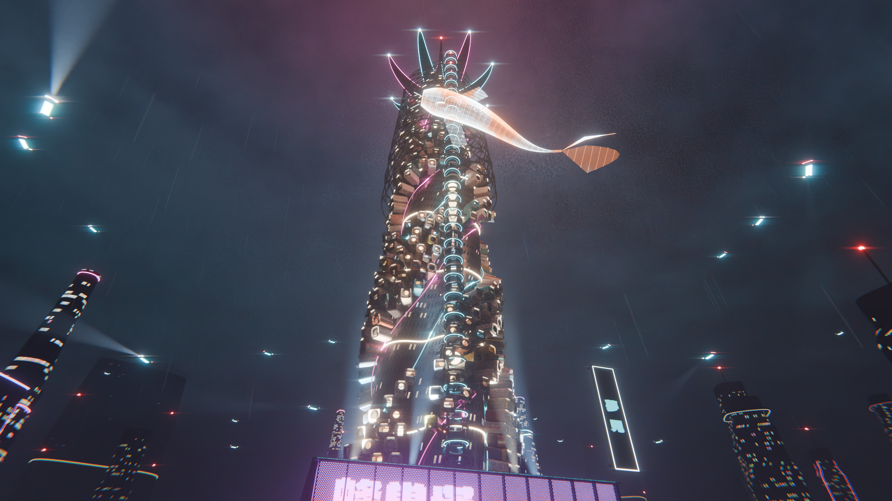

# The Capsule Spire

One piece of a cyberpunk world, designed and detailed throughout: a
freestanding capsule-housing megastructure on a rain-soaked corner of
Neo-Kowloon. Everything is generated from Python in Blender and
path-traced in **Cycles**, so neon really lights the concrete, the wet
plaza really mirrors the tower, and the haze scatters every lamp.



## The design

| Element | What it is |
|---|---|
| **Sculpted core** | A four-lobed concrete core that tapers and makes a quarter turn over 180 m (lofted freeform surface), skinned with slit windows. |
| **Capsule scales** | ~630 capsule homes (porthole, louvred and balcony units: rounded shells, drip edges, vents, porch lights, lit rooms behind glass) plugged into the core in three helical currents, tilted and staggered like koi scales. |
| **Light currents** | Neon tubes trace the edges of the capsule currents; light pulses run up the spiral. |
| **Spinal lift shafts** | Two glass shafts in the core's valleys, wrapped in vertebrae (rings with fins reaching for the core), cabins as glowing beads, tied back by sagging tendon catwalks hung with red lanterns. |
| **Exoskeleton** | A hexagonal steel shell on the upper third, its cells tightening with height; Wireframe + Subdivision give it organic, flowing nodes. |
| **Lotus crown** | Eight cantilevered petals with neon edges around a finned beacon needle; projectors at the petal tips cast the holographic koi that circles the tower. |
| **Podium** | Real shop interiors (ramen bar with lanterns, clinic, neon bar, stocked mart, shuttered units) behind glazing, 3D shop names, a wave canopy of curved lit ribs, a glazed restaurant level, and perforated metal screens on all four faces with kanji cut out of them, glowing from behind. |
| **Plaza** | Wet stone paving, a raised black koi pond with holographic lilies, lotus flowers and koi, steam vents, light rails that flow toward the tower, a street with lane lights. |
| **Hover-car** | Syd Mead-inspired: lofted lacquer-red/graphite body with panel seams and a cyan pinstripe, tinted canopy over a glowing dash, four thruster nacelles on articulated swing arms. |
| **Atmosphere** | Low mist layer, volumetric haze, rain streaks that catch the neon, a glowing cloud ceiling, distant sculpted towers reduced to silhouettes. |

## Screenshots (3840 × 2160)

See [`screenshots/`](screenshots/).

## Rendering it yourself

Requires Python 3.13 with the `bpy` wheel (Blender as a module) and Pillow:

```bash
python3 -m venv .venv && .venv/bin/pip install bpy pillow numpy
# previews
.venv/bin/python blender/build.py --shots all --res 960x540 --samples 16 --out renders/preview
# 4K finals
.venv/bin/python blender/build.py --shots all --res 3840x2160 --samples 40 --final --out renders/4k
# save the scene to open in Blender
.venv/bin/python blender/build.py --save capsule_spire.blend
```

## Code

```
blender/build.py                  entry point: build the scene, render shots, save .blend
blender/cityparts/
  capsule_spire.py                the tower: core, capsule scales, podium, plaza, uplighting
  spire_details.py                signature details: light currents, spinal shafts, catwalks,
                                  lotus crown, wave canopy, kanji screens, koi pond, steam,
                                  flow rails, hover-car, sweep/loft helpers
  freeform.py                     freeform engine: lofted sculpted towers, hex exoskeletons
  hive.py                         capsule module meshes
  shops.py                        shop interiors
  holo.py                         holographic koi
  signs.py                        3D lettering, neon tubes, poster art
  materials.py                    Cycles node materials
  scene.py shots.py clouds.py     render/atmosphere setup, cameras, cloud deck
assets/fonts/                     OFL fonts (Google Fonts)
```

Earlier modules (`spire.py`, `helix.py`, `monolith.py`, `bridges.py`, `street.py`,
`skyline.py`, `fabric.py`) belong to the first, city-scale version and are not
part of the default build.

All brand names in the scene are invented.
